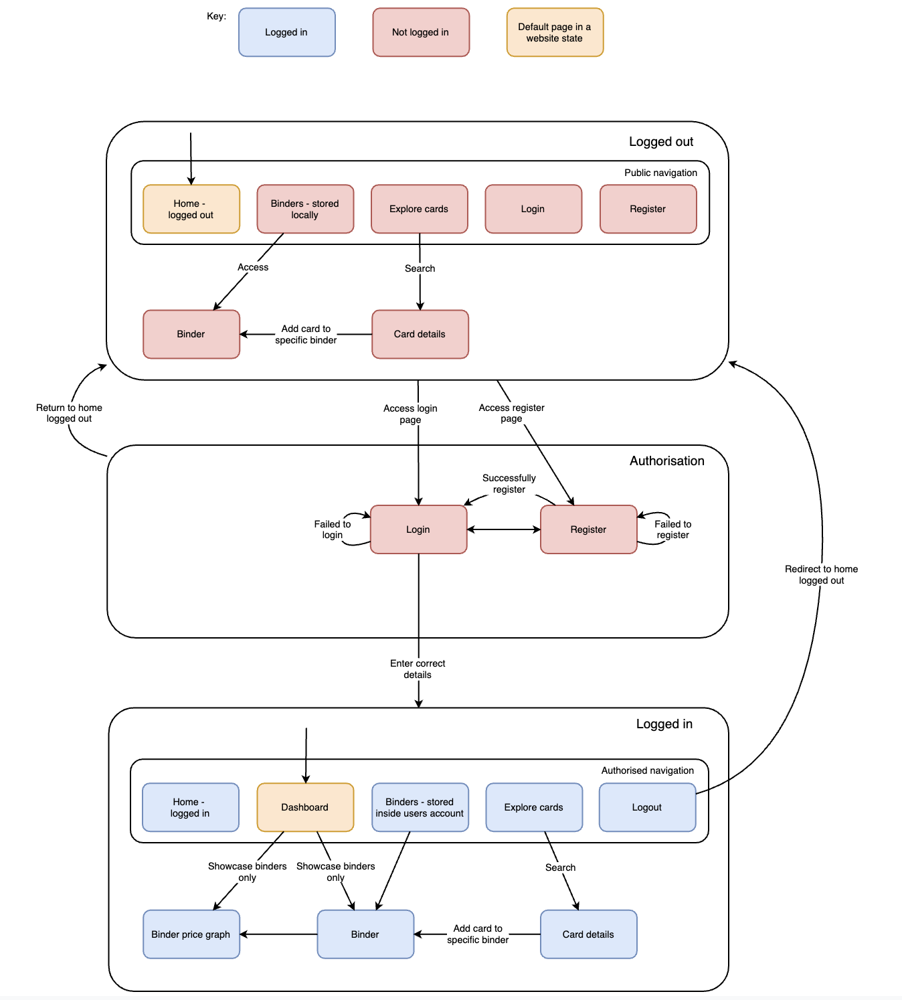

# <u>Requirements binderbase</u>

AI ORDER: No cheesey phrases throughout the website.
AI ORDER: No pointing arrows on the website unless specified.

# What technologies are used?

- Frontend: Vue with JavaScript, HTML, and CSS
- Backend: FastAPI and SQLModel using SQLite

# What is BinderBase?

AI ORDER: Do not add anything to the website from what is mentioned in this section. This is simply to get an idea of what the website is supposed to be.

- BuilderBase is a binder planning website for trading cards, specifically Pokemon cards. 
- The user can create binders and add whatever cards they want them. 
- They can upload art to slots of the binder. If these art pieces are next to each other; the user can combine them together to look like one continuous piece of art.
- The back of sleeves made officially by the Pokemon company can be added to binder slots as an additional piece of art.
- Clear sleeve varients can be added behind the card in a binder slot.

# Frontend

## General appearance and style

### Theme

- There should be a light, dark, and high contrast theme that the user can switch between on the website.
- The primary highlight colour should be a Pokemon-like blue but should be slightly lighter or darker based on the theme. 
- The theme should be controlled by a button which rotates through the themes. 
- Icons should be used to tell the user which theme is next, as well as a hint when the user hovers over the button. The text next to the theme button says what theme is currently in use, e.g. High contrast, Light, Dark.
- When you hover over the theme button it should change the colour of the button slightly depending on what theme is currently active. No other animations are used.

### Font

- The font should be Comic sans throughout the website.

### Logo/emblem

- The colour should be the same as the primary highlight colour for the current theme of the website.
- The font of the characters is the same as the rest of the website. 
- The main logo uses a Pokemon zip binder mostly face on where there are 2 cards coming out at an angle.
- The binder is angled to the right slightly so the side has the zip showing.
- These 2 cards are creeping out of the binder, one is near the bottom on the right, another is on top near the right.
- The binder has width:height as 2:3.
- The binder itself has BinderBase on it. Each word is on a seperate line and should cover most of the binder.
- Each card has a B inside it where each card is the same colour as its background and has the same border colour as the B's.
- The base logo is scaled to fit across the website. For example, any gaps inside the logo should be scaled down if the logo is made smaller.
- The logo appears in the home page and navigation menu.

## Navigation

## Home page

- BinderBase has a home page which is the first page the user is greated with upon loading the website. This page should contain everything the user needs to know about the website.
- There is a typewriter animation affect on the phrase "Welcome to BinderBase." which goes round in a loop. Before the typewriter reaches each character, it isn't seen. The animation should last 5 seconds and there is a 0.5 second pause between starting the animation again.